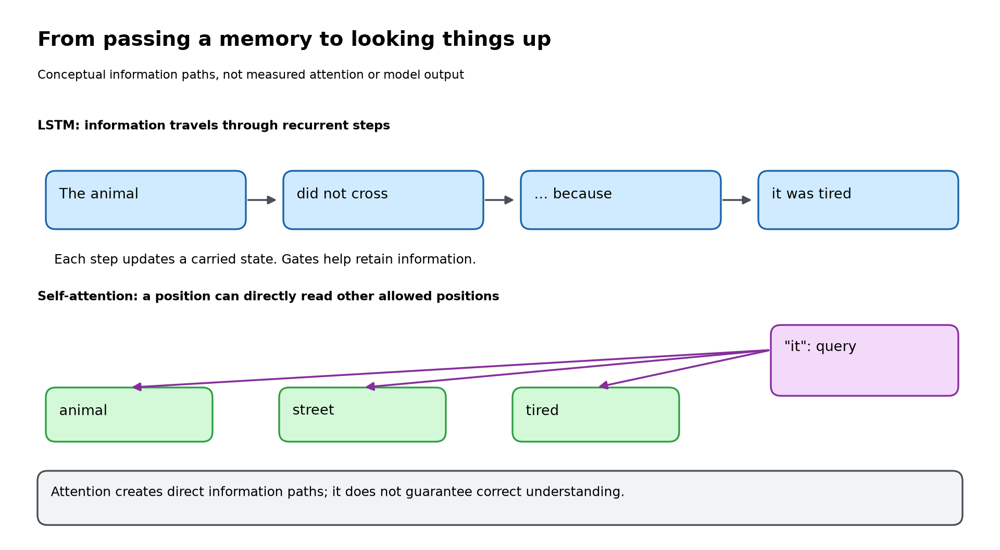
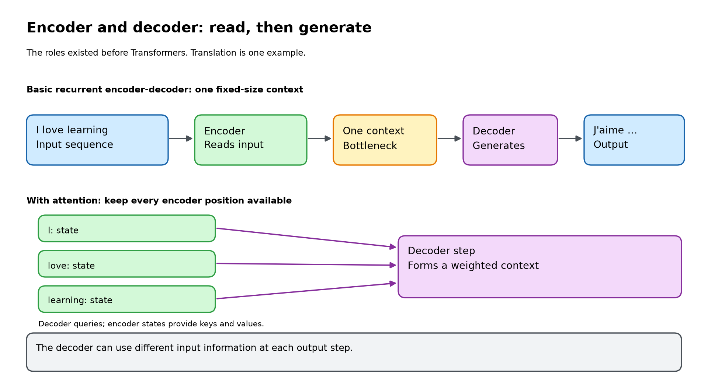
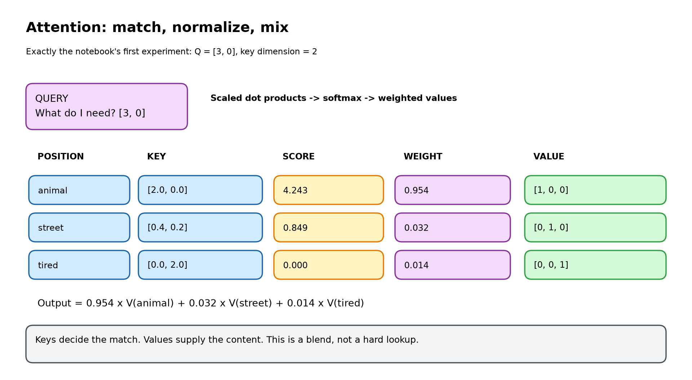
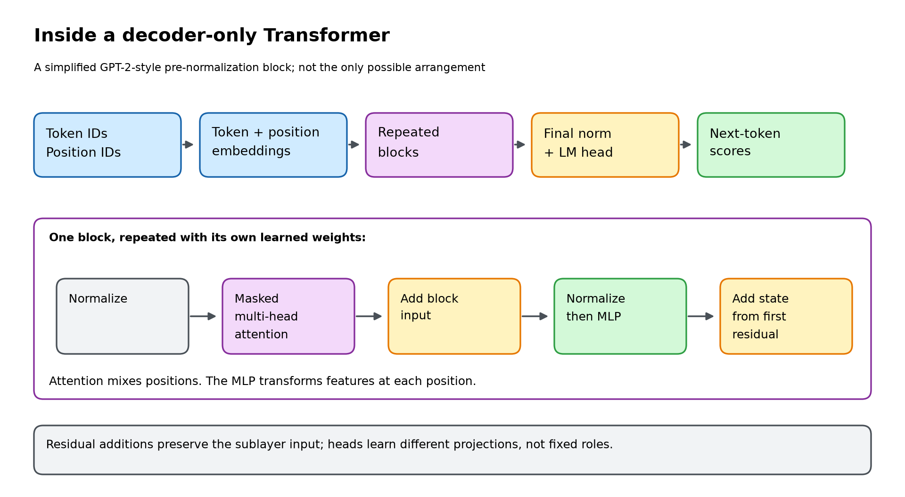
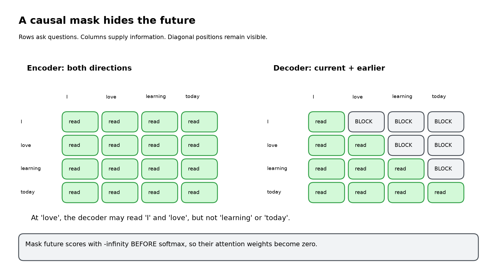
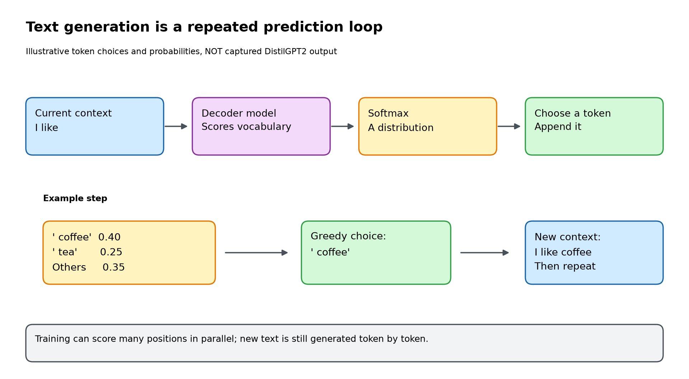

# Presenter study guide: From LSTMs to Transformers

This is your preparation material, not extra content to teach in the hour.
Keep the [participant notebook](Session3_From_LSTMs_to_Transformers.ipynb) on screen
and this guide in a separate window. The diagrams are original workshop illustrations;
their editable `.excalidraw` sources and SVG versions live in `assets/transformers/`.

## Start here: a 35-minute study route

| Your preparation time | What to do |
|---|---|
| 0-5 minutes | Read the six-sentence story below and section 1. |
| 5-15 minutes | Read sections 2-3; work through the attention numbers once. |
| 15-22 minutes | Read sections 4-5; explain the triangular mask out loud. |
| 22-30 minutes | Run the notebook, including the real model. Try both prompts. |
| 30-35 minutes | Read the questions and rehearse the opening and closing. |

Install packages and download the model **before** this preparation timer.
You are ready when you can explain the attention example and causal mask without
reading a formula. You do not need to derive gradients or implement training.

### The whole session in six sentences

1. An LSTM processes a sequence through recurrent updates to its memory.
2. An encoder reads an input; a decoder produces an output.
3. Attention lets a position retrieve a weighted mixture of information from
   available positions.
4. A Transformer combines attention with positional information, feed-forward
   layers, normalization, and residual connections.
5. An autoregressive decoder cannot read future tokens, so it uses a causal mask.
6. A language model predicts the next token, appends a chosen token, and repeats.

## 1. Bridge from LSTMs [teach at 0-5 minutes]



**Understand it yourself.** In an LSTM, the next recurrent step depends on the
previous step's state. Gates regulate what information is retained or changed.
LSTMs were designed to improve long-range learning compared with basic RNNs;
do not describe them as having no long-term memory.

The relevant limitations are the sequential dependency and the difficulty of
carrying everything useful through a long chain. Attention creates a more direct
information route between positions. This does not mean a Transformer has
unlimited context or always handles long inputs well.

**Say this:**

> "You already know how an LSTM carries memory through a sentence. Today we ask:
> what if a word could directly look up useful information from other positions,
> rather than receiving everything through a chain of recurrent updates?"

**Point at the picture.** Follow the arrows across the top, then the direct
connections below. The lower arrows are a conceptual illustration, not measured
weights from a real model.

**Ask:** "What helps interpret 'it' in 'The animal didn't cross the street because
it was tired'?" Accept a short discussion. Do not claim the notebook actually
resolves the pronoun.

**Transition:** "First, where does attention fit? Let's separate reading an input
from generating an output."

## 2. Encoder and decoder [teach at 5-15 minutes]



**Understand it yourself.** These names describe roles, not exclusively
Transformer components. A recurrent translation model can have an LSTM encoder
and an LSTM decoder.

In a basic fixed-context recurrent model, the encoder summarizes the input into
a fixed-size context. The decoder uses that context along with its state and
earlier outputs to generate a translation. The concern is not that a fixed-size
vector cannot encode anything useful; it is that compressing an entire long
sequence into that interface can be a bottleneck.

With encoder-decoder attention, the decoder can access all encoder output states.
Each output step uses a query to build a weighted context from those states.
The decoder is still generating one output token at a time.

**Say this:**

> "Think of the encoder as preparing notes from the input, and the decoder as
> writing the output. Without attention, the interface can be one compressed
> summary. With attention, the writer can consult the notes again at each step."

**Point at the picture.** The orange box is the bottleneck. Below it, there are
separate per-position states. The decoder can combine those states differently
for different output steps.

**Do not overstate the analogy.** The encoder states are numeric representations,
not literal sentences or handwritten notes.

**Quick check:** a five-token input does not require a five-token output.
Also, token boundaries are not necessarily word boundaries.

**Transition:** "How does the decoder choose which notes to consult? That is the
attention calculation."

## 3. Attention and the notebook code [teach at 15-35 minutes]



### First understand Q, K, and V

Imagine searching a library:

| Concept | Analogy | Actual meaning |
|---|---|---|
| Query | Your search request | Vector used to ask for relevant information |
| Key | Searchable description of an item | Vector compared with the query |
| Value | Content of that item | Vector included in the weighted result |

The analogy is only about matching versus content. A trained network does not
receive English labels saying "this dimension means animal."

In real self-attention, the current representations form a matrix `X`. Learned
linear projections produce `Q = XW_Q`, `K = XW_K`, and `V = XW_V` (some
implementations also use biases). These weights are learned during training.
In cross-attention, decoder representations supply queries while encoder outputs
supply keys and values.

### Work through one complete calculation

The query is `[3, 0]`. The keys are:

```text
animal: [2.0, 0.0]
street: [0.4, 0.2]
tired:  [0.0, 2.0]
```

**Step 1: match with dot products.**

```text
animal: 3*2.0 + 0*0.0 = 6.0
street: 3*0.4 + 0*0.2 = 1.2
tired:  3*0.0 + 0*2.0 = 0.0
```

**Step 2: scale.** Each key has two components, so divide scores by `sqrt(2)`.
This gives approximately `[4.243, 0.849, 0.000]`.

**Step 3: normalize.** Softmax turns these into positive weights summing to 1:
approximately `[0.954, 0.032, 0.014]`. A weight is relative to the other available
keys; it is not a probability that a grammatical interpretation is correct.

**Step 4: mix values.** The demo uses:

```text
animal value: [1, 0, 0]
street value: [0, 1, 0]
tired value:  [0, 0, 1]
```

The weighted result is:

```text
0.954*[1,0,0] + 0.032*[0,1,0] + 0.014*[0,0,1]
= [0.954, 0.032, 0.014]
```

The context equals the weights **only because the values are identity vectors**.
Real values contain learned features; the context is not normally just a list of
attention weights. Key and value dimensions can differ, as they do in this demo.

**Say this:**

> "The query matches the keys. Softmax decides the proportions. Those proportions
> mix the values. We usually get a blend, not one winning word."

### Explain the code without narrating every line

| Code | What to say |
|---|---|
| `queries @ keys.T` | "Compare every query with every key." |
| `/ np.sqrt(keys.shape[-1])` | "Scale by the square root of the key dimension." |
| `softmax(scores)` | "Normalize each query's scores into weights." |
| `weights @ values` | "Mix the value vectors with those weights." |
| Subtracting the maximum inside softmax | "Keep exponentials numerically stable without changing the result." |

For one query and three keys, the weights have shape `1 x 3`. With three queries
and three keys, the weights have shape `3 x 3`.

### Run Experiment A

Before running, ask participants to predict the dominant position.

| Query | Expected observation |
|---|---|
| `[3, 0]` | Animal dominates, approximately 95.4%. |
| `[0, 3]` | Tired dominates, approximately 96.5%. |
| `[0, 0]` | Equal scores give equal weights, one third each. |

These patterns were constructed by us. No language understanding was learned in
the toy example. Restore the original query afterward if you want the printed
numbers to match the diagram.

### Run Experiment B

Now every position supplies a query, key, and value from the same sequence.
That is **self-attention**. Our toy example uses identity projections, so Q, K,
and V are all `X`; real models normally learn different projections.

Explain the heatmap row by row:

> "Choose a row: that token is asking the question. Move across the columns:
> those are the positions it reads. Each row's weights sum to one."

The cat row gives kitten more weight than road. That follows from the vectors
we assigned, not from training. Its output differs from its original vector
because it has mixed information from other positions.

**Transition:** "We have the central mechanism. What else makes it a Transformer,
and how do we stop a text generator from peeking ahead?"

## 4. Transformer blocks and the mask [teach at 35-45 minutes]



**Understand it yourself.** A token ID selects an embedding vector. Positional
information makes order available. GPT-2 adds learned position embeddings; other
Transformer families can encode position differently.

Multi-head attention runs multiple learned Q/K/V projections. The head outputs
are combined and projected. Heads are not manually assigned fixed jobs such as
"grammar head" or "pronoun head."

The feed-forward network, also called an MLP, transforms each position's features.
It uses the same network weights at every position in a block. Unlike attention,
this sublayer does not mix information across positions.

A residual connection adds a sublayer's input back to its output. Layer
normalization helps regulate feature scales. The diagram shows a simplified
GPT-2-style **pre-normalization** layout; exact ordering varies by architecture.
Different blocks have their own learned weights.

For your own understanding, the two residual additions in this diagram are:

```text
a = x + MaskedMultiHeadAttention(Normalize(x))
y = a + MLP(Normalize(a))
```

The second addition uses `a`, not the block's original `x`. The diagram omits
dropout and projection details; do not present it as a complete implementation.

**Say this:**

> "Attention exchanges information between positions. The feed-forward network
> processes that information within each position. Position information gives
> order; residual connections and normalization help the stack train."

Do not teach the internal equations of layer normalization or the MLP in this hour.

### Why the causal mask is triangular



For training on `I love learning today`, the prediction targets are shifted:

| Representation at | Allowed context | Predicts next |
|---|---|---|
| `I` | `I` | `love` |
| `love` | `I love` | `learning` |
| `learning` | `I love learning` | `today` |

The diagonal is allowed because the token at that position is already part of
the context. The target is the **following** token.

In the code, future scores become negative infinity before softmax. Their
exponentials become zero, so their weights are zero. Setting future **scores**
to zero would be wrong: `exp(0)` is 1, so those positions could still get weight.

**Run Experiment C.** First show the zeros above the diagonal. Then explain that
the code changes the final token's vector and verifies the earlier outputs stay
unchanged. This checks the actual information restriction, not just the picture.

**Training versus generation:** known training sequences can be processed across
many positions in parallel with the mask. During generation, future tokens do
not exist yet, so new tokens still have to be produced sequentially.

### The three arrangements, without three new lectures

- **BERT-like encoder:** bidirectional input representations; useful for
  classification and related understanding tasks.
- **GPT-like decoder:** causal representations and next-token prediction;
  the real demo uses this arrangement.
- **T5-like encoder-decoder:** encoder input representations plus an
  autoregressive decoder with cross-attention to that input.

An encoder-only model can predict masked tokens; "encoder" does not mean it can
never predict anything. GPT-style models do not require a separate encoder.

## 5. The real-model demo [teach at 45-55 minutes]



**Understand it yourself.** DistilGPT2 is a small pretrained completion model.
The notebook loads existing weights; it does not train them or update them when
you change the prompt. `model.eval()` selects evaluation behavior;
`torch.inference_mode()` disables gradient tracking for the demonstration.

The tokenizer returns token IDs and an attention mask. That tokenizer-provided
mask indicates valid input positions (important with padding); it is **not** the
triangular causal mask we built earlier. The GPT-2 model applies causal masking
internally.

The model's logits have shape `[batch, sequence_length, vocabulary_size]`.
`logits[0, -1]` means the first example, the final input position, and all vocabulary
scores. Softmax produces next-token probabilities. The notebook uses float64
for this displayed normalization to minimize numerical rounding effects.

**Say this:**

> "We give the model a context. It returns scores for the next token. We will
> inspect a few candidates, choose one, append it, and ask again."

### What to expect, including imperfect output

Do **not** promise that `The capital of France is` produces Paris. During our
initial run, the leading candidates included generic tokens such as `' the'`,
and greedy generation repeated a phrase about the capital of France. Outputs
can differ with dependency versions and execution details.

That is a useful teaching moment:

> "This is completion, not a reliable fact lookup. We are inspecting the
> prediction mechanism, not demonstrating a capable chatbot."

Top-five probabilities need not sum to 100%; the remaining probability is on
the rest of the vocabulary. A leading space in `' coffee'` is part of the token,
not a display bug.

Change the prompt once. Ask what changed in the distribution, not whether the
model gave the "correct" answer.

### Explain the generation loop

`argmax` chooses the highest-scoring next token: greedy decoding. That token
is appended to the input, the valid-position mask grows, and the next step runs.
The loop stops after 12 tokens or an end-of-sequence token.

The demo recomputes the context for readability. Production generation commonly
uses a key/value cache to reuse prior attention computations. You do not need to
teach caching, sampling, temperature, or fine-tuning today.

## 6. Opening, closing, and likely questions

**Opening, about 30 seconds:**

> "Last time you learned RNNs and LSTMs. Today we will not build a giant model or
> derive a long equation. We will change a few numbers, see attention move, hide
> future tokens, and watch a real model generate text one token at a time."

**Closing, about 30 seconds:**

> "The encoder-decoder names tell us the roles. Attention tells us how positions
> combine information. A Transformer packages that mechanism into blocks.
> A causal language model uses those blocks to predict the next token and repeat."

| Likely question | Short, accurate answer |
|---|---|
| Does attention replace the LSTM cell? | Standard Transformers remove recurrence and use attention plus other sublayers. Attention can also be added to an LSTM. |
| Where do Q, K, and V come from? | Learned projections of the current representations. In cross-attention, Q and K/V come from different sequences. |
| Why different keys and values? | The features useful for matching need not be the features useful to return. |
| Are attention weights explanations? | They show information mixing, not a guaranteed causal explanation or human-readable reasoning. |
| Why scale by the square root? | Dot products tend to grow with dimension; scaling helps prevent overly extreme softmax inputs. |
| Why multiple heads? | Multiple learned projections let the block combine information in different representation spaces. |
| Why positions? | Content alone is insufficient to represent word order; models add or otherwise encode positional information. |
| Is attention always fast? | Dense self-attention has a sequence-length-squared score matrix. Parallelism helps, but long context still costs memory and computation. |
| Can a decoder read the entire prompt? | At the final prompt position, all earlier prompt tokens are available. Earlier positions still cannot read later ones. |
| Why is the model sometimes wrong? | Next-token training is not a guarantee of factual correctness, and this demo uses a small model. |
| Does changing the prompt train it? | No. It changes the input context, not the learned weights. |

### Preflight and recovery

1. Use the README setup; download the model under the same account and environment
   that Jupyter uses.
2. Restart the kernel and run all cells. Confirm three live heatmaps, a top-five
   candidate list, and token-by-token generation appear.
3. Confirm all six static diagrams display. Keep the repository folder structure;
   copying only the notebook loses its relative image files.
4. Save the executed notebook locally before presenting. You then have actual
   outputs to discuss if a live run fails. Do not present example numbers as if
   they came from a failed run.
5. If behind schedule, omit the second prompt and shorten discussion. Keep the
   causal-mask example and final five-minute recap. Do not add installation or
   debugging time to the session.

**Final self-check:** without looking, explain why values are separate from keys,
why the mask allows the diagonal, and why parallel training does not imply
parallel generation. If you can do that, you understand the session's core.

### Further reading for your own preparation

- [Attention Is All You Need](https://arxiv.org/abs/1706.03762):
  the original Transformer architecture; not identical in every detail to GPT-2.
- [The Illustrated Transformer](https://jalammar.github.io/illustrated-transformer/):
  an additional visual explanation.
- [DistilGPT2 model card](https://huggingface.co/distilbert/distilgpt2):
  the demo model's intended use and limitations.
